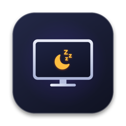

<div align="center">



# TvControl 📺🌙

**Minuteur d'extinction intelligent pour Smart TV sur Wi-Fi — 100 % intégré à la barre des menus macOS**

[](https://github.com/NadhirBM74/TvControl/releases/latest)
[](https://swift.org)
[](https://github.com/NadhirBM74/TvControl/releases/latest)
[](LICENSE)

[**📥 Télécharger TvControl.dmg (Dernière Version)**](https://github.com/NadhirBM74/TvControl/releases/latest)

</div>

---

## 📖 Présentation

**TvControl** est une application native macOS ultra-légère écrite en **Swift & SwiftUI**, conçue pour vivre exclusivement dans la **barre des menus** (à la manière d'**EjectBar**). Elle vous permet de programmer l'extinction automatique de votre télévision connectée en Wi-Fi en un seul clic grâce à 5 choix de minuteurs rapides (**1h, 2h, 3h, 4h et 5h**) ou d'éteindre votre TV instantanément depuis votre Mac.

Plus besoin de chercher votre télécommande avant de dormir : lancez un minuteur depuis la barre des menus de votre Mac, suivez le décompte en direct à côté de l'icône TV, et laissez **TvControl** envoyer le signal d'extinction sur votre réseau local Wi-Fi une fois le temps écoulé.

---

## ✨ Fonctionnalités Principales

### 🖥️ 1. Expérience 100 % Barre des Menus (Style EjectBar)
- **Zéro encombrement dans le Dock** (`LSUIElement = true`) : l'application réside uniquement dans la barre des menus macOS.
- **Popover compact et épuré** : accès immédiat à la TV sélectionnée, au statut de connexion Wi-Fi et aux préréglages de minuteur.
- **Décompte en temps réel dans la barre des menus** : affiche le temps restant (ex. `1h 42m` ou `04:59`) directement à côté de l'icône TV.
- **Menu contextuel rapide (Clic droit)** : lancez un minuteur `1h` à `5h`, annulez un décompte ou éteignez la TV immédiatement sans même ouvrir le popover.

### ⏱️ 2. Minuteur d'Extinction Intelligent
- **5 Préréglages dédiés** : **1 heure**, **2 heures**, **3 heures**, **4 heures** et **5 heures**, avec affichage automatique de l'heure exacte d'extinction prévue (ex. *Extinction à 02:30*).
- **Contrôle flexible en cours de route** :
  - Barre de progression visuelle et compteur numérique `HH:MM:SS`.
  - Bouton **`+15 min`** pour prolonger facilement votre soirée.
  - Bouton **Annuler** en un clic.
- **Prévention de veille macOS (`NSActivityOptions`)** : empêche le Mac de passer en veille profonde tant qu'un minuteur est actif afin de garantir l'envoi du paquet Wi-Fi d'extinction à `00:00:00`.
- **Alertes & Retours sonores** :
  - Notification macOS envoyée **5 minutes avant l'extinction** de la télévision.
  - Son de confirmation macOS lors de l'envoi de la commande d'extinction.

### 📡 3. Détection & Extinction Wi-Fi Multi-Marques
Dans **Paramètres > Téléviseurs Wi-Fi**, **TvControl** scanne automatiquement votre réseau local via **3 moteurs simultanés** :
1. **SSDP / UPnP Multicast** (`239.255.255.250:1900`) avec analyse automatique des descripteurs XML UPnP (`friendlyName`, `manufacturer`, `modelName`).
2. **Bonjour / mDNS** (`_googlecast._tcp`, `_airplay._tcp`, `_hap._tcp`, `_adb._tcp`).
3. **Scan actif haute vitesse du sous-réseau Wi-Fi & table ARP** sur les ports de contrôle Smart TV.

| Marque / Système | Protocole de découverte & contrôle | Ports utilisés | Appairage |
| :--- | :--- | :---: | :--- |
| **Samsung Smart TV (Tizen)** | WebSocket sécurisé `samsung.remote.control` (`KEY_POWEROFF` / `KEY_POWER`) | `8002` (WSS) / `8001` (WS) | Sauvegarde auto du `token` |
| **LG webOS TV** | WebSocket SSAP (`ssap://system/turnOff`) | `3000` (WS) / `3001` (WSS) | Sauvegarde auto de la `client-key` |
| **Roku TV / TCL / Hisense** | API REST Roku ECP (`POST /keypress/PowerOff`) | `8060` | Aucun appairage requis |
| **Sony Bravia** | API JSON-RPC (`setPowerStatus`) & SOAP IRCC-IP | `80` | Clé pré-partagée (`X-Auth-PSK`) |
| **Android TV / Google TV / Fire TV** | Google Cast / ADB sur Wi-Fi (`KEYCODE_SLEEP 223`) | `5555` / `8008` | Autorisation ADB |
| **Philips JointSpace** | API REST JointSpace (`POST /6/input/key` `Standby`) | `1925` / `1926` | Direct |
| **Webhook HTTP / Domotique** | Requête HTTP `POST` / `GET` personnalisée (Home Assistant, Homebridge...) | Personnalisable | Bearer Token optionnel |

> 💡 **Ajout manuel par IP** : Si votre télévision est sur un sous-réseau spécifique ou en veille, vous pouvez également l'ajouter manuellement via son adresse IP et tester l'extinction directement depuis les paramètres.

### 🔄 4. Mise à Jour Automatique via GitHub (Style LaunchPad)
- Vérification automatique ou manuelle des nouvelles versions publiées sur `NadhirBM74/TvControl` (via `version.json` sur CDN + API REST GitHub Releases).
- Téléchargement intégré avec barre de progression en direct.
- Extraction, remplacement atomique dans `/Applications/TvControl.app`, signature locale et relance automatique en un clic.

---

## 📦 Installation

### Option 1 : Via l'installateur DMG (Recommandé)
1. Téléchargez [**TvControl.dmg**](https://github.com/NadhirBM74/TvControl/releases/latest) depuis la page des Releases.
2. Ouvrez le fichier `.dmg` (interface **Liquid Glass**).
3. Glissez **TvControl.app** dans le dossier **Applications**.
4. Lancez **TvControl** : l'icône 📺 apparaît dans votre barre des menus macOS en haut à droite.

### Option 2 : Compiler depuis les sources
Prérequis : **macOS 13.0+** et **Xcode 15+**.

```bash
git clone https://github.com/NadhirBM74/TvControl.git
cd TvControl

# Compiler l'application Release et générer l'installateur TvControl.dmg
./Scripts/build_dmg.sh
```

Le script génère automatiquement :
- Les icônes macOS haute résolution (`16x16` à `1024x1024`) via Quartz 2D.
- Le fond d'installateur **Liquid Glass Retina 24-bit** (`1280x880`).
- L'application signée `Partage_TvControl/TvControl.app` et l'installateur `TvControl.dmg`.

---

## 🗂️ Architecture du Projet

```text
TvControl/
├── TvControl/
│   ├── AppDelegate.swift              # NSStatusItem, Popover barre des menus & menu clic droit
│   ├── Info.plist                     # Configuration LSUIElement & permissions réseau local / Bonjour
│   ├── Models/
│   │   └── SmartTV.swift              # Modèles SmartTV, TVBrand et préréglages TimerPreset (1h à 5h)
│   ├── Core/
│   │   ├── SleepTimerManager.swift    # Gestionnaire du minuteur, anti-veille macOS & notifications
│   │   ├── TVDiscoveryManager.swift   # Scanner Wi-Fi (SSDP Multicast, Bonjour/mDNS, ARP & ports TV)
│   │   ├── TVController.swift         # Moteur d'extinction Wi-Fi multi-protocoles (Samsung, LG, Roku, Sony...)
│   │   └── UpdateManager.swift        # Système d'auto-update GitHub Releases avec relance automatique
│   └── Views/
│       ├── TvPopoverView.swift        # Interface Popover compacte inspirée d'EjectBar
│       └── SettingsWindowView.swift   # Fenêtre de paramètres (Scanner Wi-Fi, Général, Mise à jour GitHub)
├── Scripts/
│   ├── generate_app_icon.swift        # Générateur d'icône macOS squircle Liquid Glass
│   ├── generate_dmg_background.swift  # Générateur du fond DMG Retina 24-bit opaque
│   └── build_dmg.sh                   # Script complet de compilation Release + création du DMG
├── .github/workflows/
│   └── release.yml                    # CI/CD GitHub Actions pour compiler et publier les Releases
└── version.json                       # Métadonnées de version pour vérification rapide par CDN
```

---

## 📄 Licence

Distribué sous licence **MIT**. Réalisé par **Nadhir** (`@NadhirBM74`).
